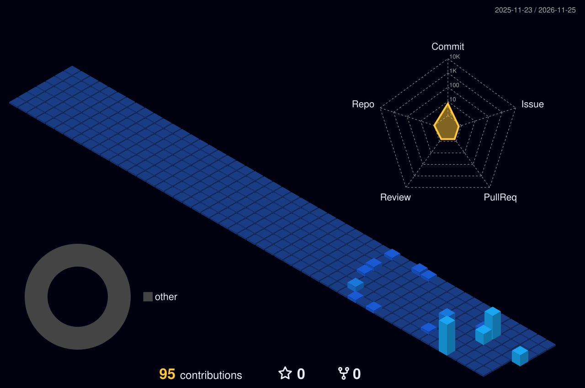

---

<table>
<tr>
<td width="54%" valign="top">

## 👨‍💻 About Me

I'm an SEO specialist interested in the technical side of the web — from crawling and indexing to website performance, automation and infrastructure.

I enjoy understanding how things work under the hood, building useful tools and learning by experimenting.

- 🔎 **Focus:** Technical SEO, website optimization & organic growth
- ⚙️ **Exploring:** Python, Linux, Docker & networking
- 🏠 **Homelab:** TrueNAS, Syncthing & self-hosted services
- 🚀 **Mindset:** Learn by building and solving real problems

</td>
<td width="46%" valign="top">

## 💻 Mission Control

</td>
</tr>
</table>

---

## 🛠️ Tech Stack & Tools

**SEO & Analytics**

**Automation & Development**

**Systems & DevOps — currently learning**

**Homelab**

---

## 🔬 SEO Workflow

---

## 📊 GitHub Statistics

<table>
<tr>
<td width="50%" align="center" valign="middle">

</td>
<td width="50%" align="center" valign="middle">

</td>
</tr>
</table>

---

## 🧊 3D Contribution Calendar

---

## 🌊 Contribution FX

### Ripple

<picture>
  <source media="(prefers-color-scheme: dark)" srcset="https://raw.githubusercontent.com/muninn1huginn/muninn1huginn/output/contribution-ripple-dark.svg" />
  
</picture>

### Equalizer

<picture>
  <source media="(prefers-color-scheme: dark)" srcset="https://raw.githubusercontent.com/muninn1huginn/muninn1huginn/output/contribution-equalizer-dark.svg" />
  
</picture>

---

## 🌱 Currently Learning

| Area | Current focus |
|:---|:---|
| 🐧 Linux | Shell, permissions, processes & system administration |
| 🐳 Docker | Images, containers, volumes & networking |
| 🌐 Networking | TCP/IP, DNS, HTTP & troubleshooting |
| 🐍 Python | Scripting and workflow automation |
| ☁️ DevOps | CI/CD and infrastructure fundamentals |

---

## 🎯 Interests

- Technical SEO, crawling, indexing and organic growth
- Python scripts and practical workflow automation
- Linux, networking, containers and self-hosting
- Homelab experiments and infrastructure projects

---

**Optimize. Automate. Experiment. Repeat.**

