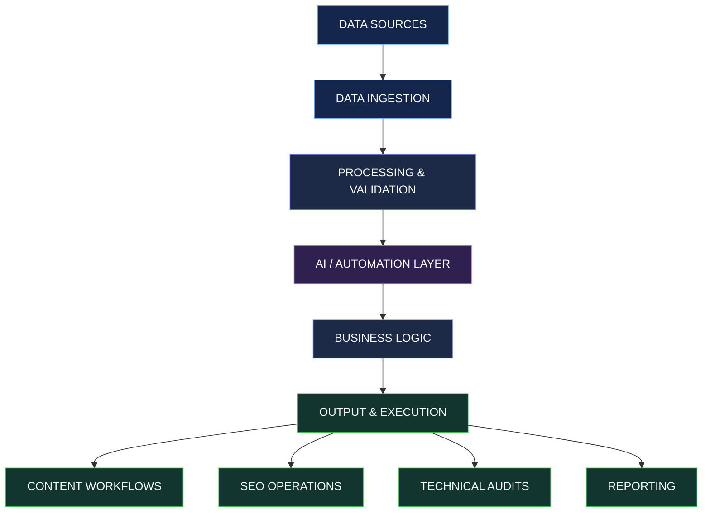

 <div align="center">


<br/>

[](https://github.com/muninn1huginn)
[](https://github.com/muninn1huginn)
[](https://github.com/muninn1huginn)

<br/>

`SYSTEM STATUS: OPERATIONAL` · `MODE: BUILD & AUTOMATE` · `MINDSET: ENGINEERING`

</div>

---

## `01` / ENGINEERING PROFILE

Technical SEO professional transitioning deeper into software engineering, AI-powered systems, and infrastructure.

My background combines organic search engineering, large-scale website optimization, data analysis, automation, and technical project management.

I have built and managed complex SEO workflows, developed an AI-powered SaaS platform independently, worked with large domain networks, and coordinated cross-functional teams.

Currently focused on expanding my engineering capabilities through hands-on work with Python, Linux, Docker, networking, and self-hosted infrastructure.

```yaml
identity:
  role: Technical SEO Engineer / AI Systems Developer
  background:
    - Technical SEO
    - SEO Systems & Automation
    - AI-assisted Development
    - Technical Project Management

engineering_focus:
  - Python & Scripting
  - Linux Administration
  - Docker & Containers
  - Networking & Infrastructure
  - CI/CD Fundamentals
  - Self-hosted Systems

approach:
  - Systems Thinking
  - Automation First
  - Data-driven Decisions
  - Continuous Experimentation
```

---

## `02` / CORE ENGINEERING DOMAINS

<div align="center">

### SEARCH SYSTEMS & DATA ENGINEERING


### AI & AUTOMATION


### INFRASTRUCTURE & DEVOPS


### ANALYTICS & SEO TOOLING


</div>

---

## `03` / SYSTEMS & PROJECT EXPERIENCE

<details open>
<summary><b>01 — AI-POWERED SEO PLATFORM | PRODUCT ENGINEERING</b></summary>

<br/>

**Independent SaaS Project · December 2025 — Present**

Designed and independently developed an AI-powered platform for SEO team workflows, from initial concept to product launch.

**System capabilities:**

- SERP data collection and large-scale keyword clustering.
- AI-assisted content brief generation with structured instructions.
- Link-building workflow management.
- Technical website auditing at scale.
- Role-based workflow architecture for different operational roles.
- Modular project structure for collaborative SEO operations.

**Engineering focus:**

`Product Architecture` · `AI-assisted Development` · `Workflow Design` · `Data Processing` · `Automation`

</details>

<details>
<summary><b>02 — SEO SYSTEMS & TEAM OPERATIONS | TEAM LEADERSHIP</b></summary>

<br/>

**Professional Experience · 2022 — 2025**

Worked across international organic search projects, combining technical SEO, operational management, and scalable acquisition systems.

**Technical responsibilities:**

- International SEO architecture and multi-region website structures.
- Hreflang implementation, validation, and indexation monitoring.
- Technical audits, server log analysis, and crawl diagnostics.
- Structured data and website performance optimization.
- Search algorithm update analysis and recovery planning.
- Content architecture, internal linking, and content lifecycle management.
- Backlink profile analysis and link acquisition operations.
- SEO data analysis and performance reporting.

**Systems & operations:**

- Managed distributed workflows across SEO, content, and link-building specialists.
- Designed sprint plans, assigned tasks, and reviewed deliverables.
- Coordinated technical requirements with development teams.
- Managed large-scale domain portfolios and supporting infrastructure.
- Evaluated acquisition opportunities using competitive and performance data.

**Operational scope:** International projects, multi-market environments, and cross-functional team coordination.

</details>

<details>
<summary><b>03 — SEARCH ACQUISITION & DOMAIN INFRASTRUCTURE</b></summary>

<br/>

**Professional Experience · 2020 — 2022**

Worked on organic acquisition systems, website launches, and domain infrastructure.

**Technical responsibilities:**

- Launched websites from initial keyword research to production.
- Designed information architecture and content structures.
- Managed large domain portfolios and supporting website networks.
- Evaluated expired domains through historical data and backlink analysis.
- Coordinated website restoration and content recovery.
- Developed internal linking and external link acquisition strategies.
- Monitored organic visibility and maintained search performance.

**Engineering focus:** Website lifecycle management, domain infrastructure, data analysis, and scalable SEO operations.

</details>

<sub>Project names, client identities, domains, proprietary metrics, and internal implementation details are intentionally omitted due to NDA obligations.</sub>

---

## `04` / AI & SEO SYSTEM ARCHITECTURE

<div align="center">


</div>



**Engineering principles:**

| Layer | Responsibility |
|:---|:---|
| Ingestion | Collect and normalize source data |
| Processing | Validate, filter, and structure information |
| Intelligence | Apply AI-assisted analysis and logic |
| Execution | Generate actionable outputs and workflows |
| Monitoring | Track results and identify anomalies |

---

## `05` / HOMELAB & INFRASTRUCTURE

<div align="center">


</div>

Building and maintaining a personal infrastructure environment to understand how systems operate beyond application-level development.

**Current environment:**

| Component | Technology |
|:---|:---|
| NAS / Storage | TrueNAS |
| File Synchronization | Syncthing |
| Knowledge Management | Obsidian |
| Infrastructure | Self-hosted environment |
| Automation | Python / Shell |
| Version Control | Git / GitHub |

**Areas of exploration:**

- Linux system administration.
- Storage management and permissions.
- Network fundamentals and DNS.
- Containerization with Docker.
- Service deployment and reverse proxies.
- Infrastructure monitoring.
- Backup and synchronization strategies.
- Configuration management and automation.

```bash
$ hostname
homelab

$ whoami
system_operator

$ docker ps
# Containerized services: learning & experimentation

$ systemctl --failed
# Monitor service health

$ echo "BUILD > TEST > AUTOMATE"
BUILD > TEST > AUTOMATE
```

---

## `06` / CURRENT ENGINEERING ROADMAP

| Domain | Current focus |
|:---|:---|
| 🐧 Linux | Administration, processes, permissions, services |
| 🐳 Docker | Images, containers, volumes, networking |
| 🌐 Networking | TCP/IP, DNS, HTTP, routing |
| 🐍 Python | Scripting, APIs, data processing |
| ⚙️ Git & CI/CD | Git workflows, GitHub Actions |
| 🔧 Infrastructure | Nginx, deployment, monitoring |
| ☁️ DevOps | Infrastructure as Code, automation |

<div align="center">


</div>

---

## `07` / GITHUB TELEMETRY

<div align="center">


<br/><br/>


</div>

---

## `08` / 3D CONTRIBUTION VISUALIZATION

<div align="center">


</div>

---

## `09` / CONTRIBUTION VISUAL EFFECTS

<div align="center">

### RIPPLE / CONTRIBUTION SIGNAL


### EQUALIZER / ACTIVITY SIGNAL


</div>

---

## `10` / ENGINEERING PHILOSOPHY

<div align="center">


<br/>

**BUILD SYSTEMS. AUTOMATE WORKFLOWS. SOLVE REAL PROBLEMS.**

<br/>


</div>
